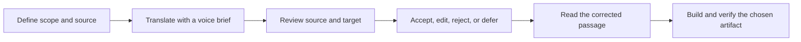

# Literary Translation Skills

**Agent skills for thoughtful literary translation, evidence-based editing, and reliable EPUB delivery.**

[](https://github.com/deprav1/literary-translation-skills/actions/workflows/validate.yml)
[](LICENSE)
[](https://agentskills.io/)

[Русское описание](README.ru.md) · [Install](docs/INSTALL.md) · [Skill catalog](#skill-catalog) · [Examples](examples/README.md) · [Contributing](CONTRIBUTING.md)

## Try the blind translation test

**[Без лица — read three versions, choose, then reveal the translators](https://deprav1.github.io/literary-translation-skills/).** A 48-fragment corpus including Cory Doctorow’s 2006 “When Sysadmins Ruled the Earth” with deterministic cohorts of 20, two AI voting conditions, published translations, and a shared vote counter. No account required. Read the [methodology, text licenses, and data policy](site/CONTENT.md). It is an open preference pilot, not proof of general model or translator quality.

The current AI candidates were regenerated in fresh Sol sessions with identical English context: a short request, planned craft, and craft followed by QA editing. See the [execution record](site/research/fresh-v5/record.json). Reference translations were not supplied to these runs; prior model training remains outside this control.

Translate a scene without flattening its voice. Review a paragraph without inventing errors. Produce an EPUB without mistaking valid XML for a good translation.

This repository contains reusable `SKILL.md` instructions and small reference templates. It is **not a translation API, an automatic book converter, or a collection of book texts**. You bring the source, the translation, and an agent capable of using skills.

## Quick start

Discover available skills with the [Skills CLI](https://github.com/vercel-labs/skills):

```sh
npx skills add deprav1/literary-translation-skills --list
```

Install the four general skills for Codex in the current project:

```sh
npx skills add deprav1/literary-translation-skills --agent codex \
  --skill literary-translation-craft \
  --skill literary-translation-qa \
  --skill literary-translation-evaluation \
  --skill epub-translation-production
```

For a user-wide installation, add `--global`. The CLI also supports other agents; see its [supported agents](https://github.com/vercel-labs/skills#supported-agents). Actual invocation and discovery depend on the host application. For Codex's built-in installer, PowerShell instructions, and a manual copy option, read [Installation](docs/INSTALL.md).

Then ask:

```text
Use $literary-translation-qa to review these two source/translation paragraphs.
Separate factual errors, uncertain readings, and stylistic preferences.
Suggest changes only where you can explain their effect.
```

## Skill catalog

### General skills

| Skill | Use it for | What it adds |
|---|---|---|
| [literary-translation-craft](skills/literary-translation-craft/SKILL.md) | Translating or editing literary prose, poetry, or dialogue | A voice brief, scene context, functional fidelity, rhythm, recurring language, and justified transformations |
| [literary-translation-qa](skills/literary-translation-qa/SKILL.md) | Assessing an excerpt, a sample, or a complete translation | Source-based findings, error vs preference classification, independent decisions, and exact before/after blocks |
| [literary-translation-evaluation](skills/literary-translation-evaluation/SKILL.md) | Comparing candidates or designing a translation evaluation | Hard-failure gates, blind pairwise choice, compact dimensions, and explicit evidence limits |
| [epub-translation-production](skills/epub-translation-production/SKILL.md) | Preparing or revising an EPUB | Immutable editions, precise text/markup checks, links and notes, responsive typography, and traceable validation |

The craft, QA, and evaluation skills work with any stated source/target language pair. Russian examples are included. A skill never implies knowledge of an original language that the agent has not actually inspected.

### Optional book profiles

| Skill | Focus | Boundary |
|---|---|---|
| [amatka-literary-ru](skills/amatka-literary-ru/SKILL.md) | Karin Tidbeck: restrained voice, naming as action, recurring labels, and controlled uncertainty | English-source → Russian editorial profile; spelling choices are provisional, not an official translation |
| [ngai-gimmick-ru](skills/ngai-gimmick-ru/SKILL.md) | Sianne Ngai: aesthetic judgment, Marxian terms, ambivalence, and quotation layers | Book-specific terminology does not override context |
| [blank-space-ru-translation](skills/blank-space-ru-translation/SKILL.md) | W. David Marx: cultural history, argumentative qualifiers, irony, and title policy | A working editorial profile, not an endorsed edition |

Install profiles individually when working on the corresponding book. They contain original editorial guidance and short terminology notes, **not chapters, full translations, or copyrighted book files**.

## The workflow



Each step has its own evidence. A delivered paragraph is not automatically reviewed. A reviewer's suggestion is not an accepted correction. A passing EPUBCheck report is not proof of literary quality. A browser screenshot is not a test of a reading app's TTS.

Read the [full workflow](docs/WORKFLOW.md) for scope selection, decision records, checkpoints, and completion criteria.

## What makes these skills useful

- **Scale to the request.** Two paragraphs get a close reading, not an unnecessary whole-book production process.
- **Preserve effects, not word order.** Natural syntax, idiomatic phrasing, and justified compensation are allowed. Missing actions or erased uncertainty are not excused by fluency.
- **Keep voices distinct.** A narrator, a child, a bureaucratic report, and a broken utterance should not all sound equally polished.
- **Challenge the reviewer.** High confidence, a matching quote, or a label such as “major” does not make a suggestion correct.
- **Protect editions.** New releases use explicit inputs, hashes, and separate output paths. A CSS pass must not restore an older textual version.
- **Keep installation portable.** Every skill carries its necessary reference files inside its own directory. No personal paths, hidden memory, provider credentials, or book-project folders are required.

## Three common failures, handled explicitly

| Situation | Bad shortcut | Expected behavior |
|---|---|---|
| “Perhaps she had left” becomes a definite assertion | Call it smoother Russian | Restore the uncertainty or justify a contextual reading |
| Reviewer insists that *first floor* always means the first numbered floor | Trust a dictionary or confidence score | Inspect locale, building layout, and movement before deciding |
| A reviewer puts a proposed sentence in quotation marks | Paste the entire proposal into narration | Apply only the intended literal text and reread the full paragraph |

See [synthetic worked examples](examples/README.md) and the [review-decision template](skills/literary-translation-qa/references/review-decision.json).

## Compatibility and dependencies

- Standard folder layout: `skills/<name>/SKILL.md` with YAML frontmatter.
- Optional `agents/openai.yaml` metadata improves the Codex skill picker.
- Skill instructions themselves do not require Python, a particular model, or a paid service.
- Repository validation requires **Python 3.10+**, with no third-party Python dependencies.
- EPUB work may use EPUBCheck and a browser/renderer. They are separate tools and are not bundled here.
- Audio generation is outside these skills. An EPUB prepared for built-in reading aloud does not itself require a speech API key.

No model is mandated. Use the provider and tools the user selected; do not silently substitute an external machine-translation service.

## Repository layout

```text
skills/
  literary-translation-craft/     # craft instructions + brief/source notes
  literary-translation-qa/        # review instructions + decision template
  literary-translation-evaluation/ # comparison and evaluation rubric
  epub-translation-production/   # production instructions + release record
  amatka-literary-ru/             # optional book profile
  ngai-gimmick-ru/                # optional book profile
  blank-space-ru-translation/     # optional book profile
docs/                            # installation, workflow, sources
examples/                        # synthetic examples and prompt recipes
scripts/validate.py              # metadata, local links, portability checks
tests/                           # validator behavior checks
.github/                         # CI and issue templates
```

## Validate and contribute

```sh
python scripts/validate.py
python -m unittest discover -s tests -v
```

CI checks skill metadata, reference links, standalone installation portability, and repository hygiene. These checks **do not grade translation quality**. The examples document intended editorial behavior; no benchmark or human-quality score is claimed.

Contributions are welcome: concise guidance, small source-based examples, language-pair notes, and improvements to reader validation. Start with [CONTRIBUTING.md](CONTRIBUTING.md). Use synthetic or appropriately licensed excerpts in issues and pull requests.

## Lower-cost translators

A [Terra/Luna development pilot](evals/budget-translation-20261030/RESULTS.md) tests first-pass translation rather than editing a Sol draft. Terra with a compact Sol brief showed a quality signal, but planning was too costly on the measured sample; Luna's tested additions regressed in this run. Full audited routes saved only about 26% (Terra) and 20% (Luna) and missed the quality gate. The evaluation skill now accounts for planning, audits, escalation and known retained errors. Run `python scripts/validate_budget_trial.py` to replay saved metrics. This is model-audited development evidence, not human literary validation.

A [second realization in fresh sessions](evals/budget-translation-20261030/replication-2/RESULTS.md) retains both runs side by side; it repeats the same 30 development sources with new audit ordering, without best-of selection or new default profiles.

A [small Sol screening](evals/sol-micro-20261031/RESULTS.md) tests meaning checks, voice checks and conservative editing on eight excerpts. None passes the declared signal rule; editing yields one stable local improvement. Six completed calls cost $0.3551 in API equivalents; reported cache hits are zero.

A [quote-guided editing follow-up](evals/sol-patch-20261031/RESULTS.md) yields two stable local improvements with supplied prior findings; a fresh audit proposes none. Four new calls cost $0.057094 in API equivalents. This supports conditional editing only; explicit cache requests still report zero cached tokens.

## Targeted skill trial

A [preregistered trial](evals/targeted-review-20261030/RESULTS.md) tested three targeted review candidates on 36 mechanism fixtures and 30 new excerpts with equal edit-call budgets and masked model review. None cleared the integration gate; existing skills remain unchanged. Run `python scripts/validate_targeted_trial.py` to replay the saved evidence and gates. This is internal model evidence, not human literary validation.

## Sources, attribution, and limits

The [source map](docs/SOURCES.md) separates professional principles from this repository's editorial and engineering choices. ALTA's evaluation guidelines inform attention to voice, style, nuance, and cultural knowledge. The Authors Guild resource concerns translator attribution and professional conditions. Neither is presented as a specification for our JSON records or automation.

The project is independent and is not affiliated with OpenAI, Anthropic, Vercel, ALTA, the Authors Guild, or the authors named in optional profiles. Instructions can improve a process; they cannot guarantee a flawless translation or perfect TTS in every reader.

## License

[MIT](LICENSE) for this repository's original instructions, templates, synthetic examples, and code. Contemporary Doctorow excerpts and derivative translations are **CC BY-NC-SA 2.5**, not MIT; classic dataset excerpts have separate notices. See [text licences](site/CONTENT.md). Third-party source pages and books retain their own rights. A link or editorial profile does not grant rights to reproduce a book.
